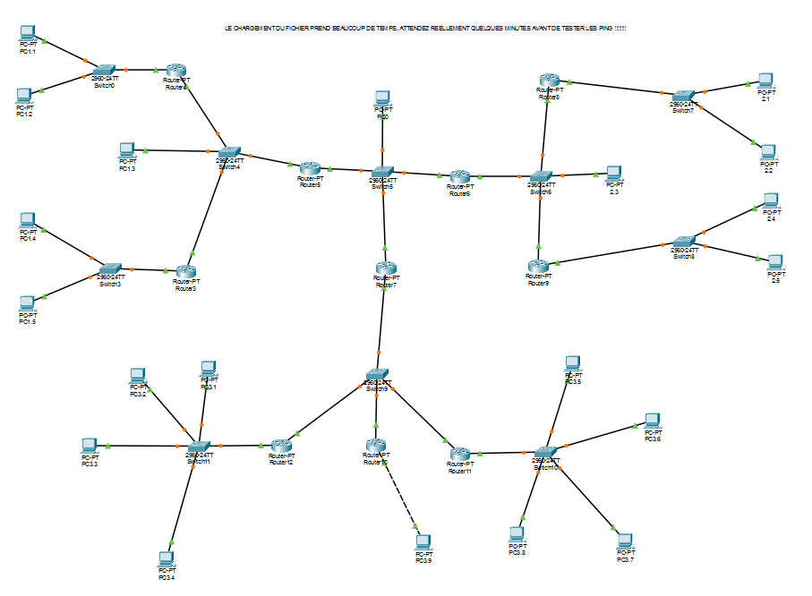
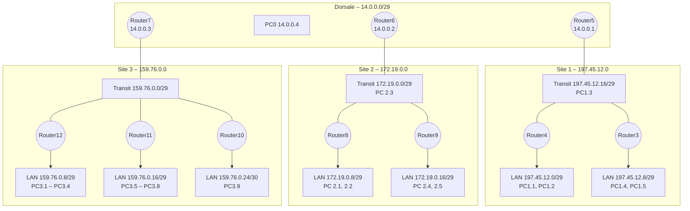

# Interconnexion multi-sites par routage statique – Projet réseaux avancés

Projet réalisé à l'ESAIP (IR3) : interconnexion de trois sites, chacun avec son propre bloc d'adresses découpé en sous-réseaux, autour d'un réseau dorsal commun. Le routage repose entièrement sur des **routes statiques** et des **routes par défaut** hiérarchiques.


## Topologie

### Capture Packet Tracer



### Schéma logique



## Plan d'adressage

| Site | Réseau | Rôle | Routeur / passerelle |
|---|---|---|---|
| Dorsale | 14.0.0.0 /29 | Interconnexion des sites | R5 .1 · R6 .2 · R7 .3 |
| Site 1 | 197.45.12.16 /29 | Transit | R5 .17 · R4 .18 · R3 .19 |
| Site 1 | 197.45.12.0 /29 | LAN | R4 .1 |
| Site 1 | 197.45.12.8 /29 | LAN | R3 .9 |
| Site 2 | 172.19.0.0 /29 | Transit | R6 .1 · R8 .2 · R9 .3 |
| Site 2 | 172.19.0.8 /29 | LAN | R8 .9 |
| Site 2 | 172.19.0.16 /29 | LAN | R9 .17 |
| Site 3 | 159.76.0.0 /29 | Transit | R7 .1 · R12 .2 · R10 .3 · R11 .4 |
| Site 3 | 159.76.0.8 /29 | LAN | R12 .9 |
| Site 3 | 159.76.0.16 /29 | LAN | R11 .17 |
| Site 3 | 159.76.0.24 /30 | LAN | R10 .25 |

## Logique de routage

Le routage est hiérarchique :

1. **Routeurs d'accès** (R3, R4, R8 à R12) : une route par défaut vers le routeur de bordure de leur site.
2. **Routeurs de bordure** (R6, R7) : des routes statiques vers chaque LAN de leur site, plus une route par défaut vers R5.
3. **Routeur central** (R5) : une route vers chaque site, résumée en /16 pour les sites 2 et 3.

```cisco
! Router5 – routeur central
ip route 197.45.12.0   255.255.255.248 197.45.12.18
ip route 197.45.12.8   255.255.255.248 197.45.12.19
ip route 172.19.0.0    255.255.0.0     14.0.0.2
ip route 159.76.0.0    255.255.0.0     14.0.0.3

! Router7 – bordure du site 3
ip route 0.0.0.0       0.0.0.0         14.0.0.1
ip route 159.76.0.8    255.255.255.248 159.76.0.2
ip route 159.76.0.16   255.255.255.248 159.76.0.4
ip route 159.76.0.24   255.255.255.248 159.76.0.3
```

Toutes les configurations sont regroupées dans [`CONFIGURATIONS.md`](CONFIGURATIONS.md).

## Compétences mises en œuvre

- Découpage en sous-réseaux (/29, /30) et plan d'adressage multi-sites
- Routage statique, routes par défaut et résumé de routes
- Conception hiérarchique (accès, bordure, dorsale)
- Diagnostic : `show ip route`, `ping`, `tracert` d'un site à l'autre

## Utilisation

Ouvrir [`projet-reseaux-avances.pkt`](projet-reseaux-avances.pkt) avec **Cisco Packet Tracer 8.2** ou plus récent, puis tester par exemple un `tracert 159.76.0.10` depuis PC1.1. Testé sous Packet Tracer 9.0 : les trois sites communiquent entre eux. Comme l'indique la note du schéma, les premiers pings peuvent échouer le temps de la convergence (résolution ARP).

## Contenu du dossier

| Élément | Description |
|---|---|
| [`projet-reseaux-avances.pkt`](projet-reseaux-avances.pkt) | Fichier Cisco Packet Tracer du projet |
| [`CONFIGURATIONS.md`](CONFIGURATIONS.md) | Configuration de chaque équipement et adressage des postes, en un seul fichier |
| [`configs/`](configs/) | Une configuration brute par équipement (`.txt`) |
| [`images/`](images/) | Captures de la topologie |

## Auteur

**Anatole BERNARD** – étudiant ingénieur à l'ESAIP
